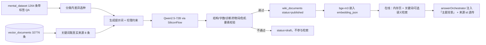

# LLM Wiki 知识层

> 用 LLM 把现有知识库离线聚合成按主题组织的 wiki 页；在线回答只检索已发布页，不现场生成。
> 生成逻辑在 PsyQA/server/src/services/wiki/，管理端在「知识库与 LLM Wiki → LLM Wiki」标签页。

## 一、为什么加这一层

现有知识库是 1264 条带标签 QA + 32776 条 vector_documents。检索按问题相似度取 top3，遇到需要「背景 + 表现 + 原因 + 做法 + 何时求助」的整段说明时，三条短 QA 拼不出完整结构。

LLM Wiki 补的是「主题页」：一页一个主题，LLM 从同一分类的真实文档里提炼，校验后发布；检索时作为背景知识注入，并保留全部来源 doc id。

## 二、数据流

## 三、存储

SQLite 表 wiki_documents（在 server/src/db/database.ts 建表）：

| 字段 | 说明 |
|------|------|
| id | slug，如 academic_stress-3a1dce3f，由分类 + 种子问题哈希稳定生成 |
| title / summary | 主题名 / 一句话理解 |
| category | 10 个分类之一 |
| sections_json | 4 段：常见表现 / 可能的成因 / 可以尝试的做法 / 什么时候该求助 |
| sources_json | [{docId, question, answer}]，docId 来自 vector_documents，真实可回查 |
| embedding_json | bge-m3 1024 维嵌入，供后续语义检索/管理端重建 |
| status | draft / published / archived；只有 published 进在线检索 |
| model / prompt_hash / updated_at | 生成模型、幂等哈希、更新时间 |

独立于 mental_dataset.json 和 vector_documents：生成失败或回滚不需要动原知识库。

## 四、生成与重建

在 PsyQA/ 下：

    # 全 10 类，每类 8 页（约 80 页，后台跑约 10-20 分钟）
    npm run wiki:build

    # 只跑一个分类
    npx ts-node server/scripts/build-llm-wiki.ts --category=academic_stress --per-category=8

    # 只看效果不写库
    npm run wiki:build:dry

    # 指定生成模型 / 强制重建
    npx ts-node server/scripts/build-llm-wiki.ts --model=Qwen/Qwen2.5-72B-Instruct --force=true

- 生成进程独立于服务器，不会阻塞问答；管理端「开始重建」会 spawn 同一个脚本并轮询状态。
- 幂等：同一 slug + 同一 prompt_hash 会跳过；--force 才重写。
- 报告：server/data/llm_wiki_build_report.json（每类 published/draft/skipped/failed、样例、错误原因）。
- 校验不通过的页落 draft，管理端可见，但线上不检索。
- 重生成 draft：`npx ts-node server/scripts/fix-wiki-quality.ts --include-drafts`；标题个案化的 draft 会按新提示词重写，医疗/危机敏感种子（精神病、幻觉、自杀、诊断等）默认跳过，保留 draft 等人工审核。

## 五、在线检索与引用

server/src/services/wiki/wikiService.ts：

- 启动/首次访问时把 published 页与嵌入载入内存（几十页，开销可忽略）；
- 默认关键词打分（2-3 字 n-gram，无网络调用，不会拖慢首字）；设置 PSYQA_WIKI_SEMANTIC=1 时额外尝试语义分，预算 120ms，超时回退关键词；
- 同分类页足够时优先只在同分类内取（不足 topK 才回退全库），减少跨分类蹭关键词；分类命中再 +0.08，阈值 0.06，最多取 2 页；任何异常返回 []；
- 风险 high/critical 或 intent.kind === 'crisis' 时不注入 wiki，安全路径不受影响；
- 注入位置：answerOrchestrator.ts 的「参考知识」之后，只给 1 张最短的内部主题背景；明确「仅供组织思路、不要复述、先回应用户原话」，避免把回答带成通用科普；
- 已发布页在内存缓存 5 分钟：后台重建完成后，线上最多 5 分钟内看到新页（管理端列表实时）；
- wiki 只服务模型：不进入 knowledgeSources，也不在前端展示（前端保持原样）；界面知识引用仍来自原 QA 条目，来源 doc id 不受影响；
- ReAct 路径同样把 1 张主题背景作为「内部主题背景」注入 user prompt（只用于把握方向，不要复述）；

## 六、管理端

学校端 → 知识库与 LLM Wiki → LLM Wiki：

- 列表：分类/状态/关键词筛选、分页、来源数、是否已嵌入；
- 详情：四段正文、相关追问、来源文档 doc id 与问题；
- 状态：published（线上可检索）/ draft / archived；
- 重建：选分类、每类页数，后台执行，列表自动轮询状态。

## 七、环境变量

| 变量 | 默认 | 说明 |
|------|------|------|
| WIKI_LLM_MODEL | Qwen/Qwen2.5-72B-Instruct | 生成模型（SiliconFlow 模型名） |
| PSYQA_WIKI_ENABLED | 开启 | 设为 0 关闭在线 wiki 注入 |
| PSYQA_WIKI_SEMANTIC | 关闭 | 设为 1 开启 120ms 预算的语义分（失败回退关键词） |

## 八、质量检查

    # 结构/来源 id/禁止说法/危机要素检查
    python ../scripts/eval_wiki.py

    # 改过检索/回答 → 必须按规则跑
    cd PsyQA && npm run eval:ragas

本机如果开着系统代理（Python urllib 会读 Windows 代理），可能出现 SSL EOF；
先设 NO_PROXY=* 再跑评测，或在脚本里显式绕过代理。

## 九、边界与回滚

- 只写「心理科普 + 自助支持」，不诊断、不开药、不写治疗步骤、不替代专业帮助；危机页必须带 400-161-9995 / 120 / 可信的人。
- 生成不修改 mental_dataset.json，不重排原检索；回滚：删 wiki_documents 行和 server/data/llm_wiki* 即可。
- 管理端只允许改 status，正文由脚本重建，避免绕过校验。